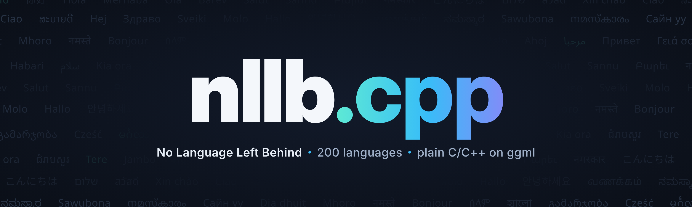

# nllb.cpp

<p align="center">
  
</p>

<p align="center">
  <a href="LICENSE"></a>
  <a href="https://github.com/Jaydeep505/nllb.cpp/releases"></a>
  <a href="https://github.com/Jaydeep505/nllb.cpp/actions/workflows/ci.yml"></a>
  <a href="https://huggingface.co/JaydeepGupta/nllb-200-distilled-600M-GGUF"></a>
</p>

`facebook/nllb-200-distilled-600M` in C++ on ggml: one GGUF, no Python at runtime, no dependency but vendored ggml.

High-performance inference of Meta's [NLLB-200](https://huggingface.co/facebook/nllb-200-distilled-600M)
machine translation model (600M distilled):

- Plain C/C++ implementation without dependencies (only the vendored [ggml](https://github.com/ggml-org/ggml))
- Built-in tokenizer, so no Python or sentencepiece at runtime: one GGUF file is the whole model
- Batched decoding: translate several sentences in one pass
- Support for CPU-only inference
- GPU backends: [Metal](#apple-silicon-support) on Apple Silicon and [CUDA](#nvidia-gpu-support) on NVIDIA
- Zero memory allocations per token: the compute graph's memory is reused across decode steps
- [1.4–1.8x faster than HF transformers, 3x less peak memory on Apple Silicon and 13x less host RAM on CUDA](docs/benchmarks.md).
- F16 / F32 weights and [integer quantization](examples/quantize) via `nllb-quantize`
- C-style API ([`include/nllb-c.h`](include/nllb-c.h)) for Swift and other languages
- Verified against HuggingFace: token-for-token identical output on the test sets

Supported platforms:

- [x] macOS (Apple Silicon: CPU + Metal)
- [x] [iOS](examples/nllb.swiftui) (xcframework + SwiftUI example)
- [x] Windows (CPU, CUDA)

## Quick start
 Clone the repository with recursive method and navigate to directory:
```bash
git clone --recursive https://github.com/Jaydeep505/nllb.cpp && cd nllb.cpp
```
Then, download one of models in .gguf format:
```bash
./models/download-nllb-model.sh f16        
```
Build the nllb-cli example:
```bash
#build the project
cmake -B build
cmake --build build -j --config Release
```
Start using cli for translation:(e.g. From English to German)
```bash
./build/bin/nllb-cli -m models/nllb-600M-f16.gguf \
    --src eng_Latn --tgt deu_Latn 'Hello, world!'

#for clean output
./build/bin/nllb-cli -m models/nllb-600M-f16.gguf \
    --src eng_Latn --tgt deu_Latn 'Hello, world!' 2>/dev/null
```
```bash
#Translate a .txt file:
./build/bin/nllb-cli -m models/nllb-600M-f16.gguf \
    --src deu_Latn --tgt eng_Latn < input.txt > output.txt

#To enable batching(8 lines at a time):
./build/bin/nllb-cli -m models/nllb-600M-f16.gguf \
    --src deu_Latn --tgt eng_Latn --batch 8 < input.txt > output.txt
```
For detailed usage instructions:
```bash
./build/bin/nllb-cli -h
```
## Apple silicon support
Same steps as above: It auto detects ARM NEON CPU and GPU 
```bash
cmake -B build
cmake --build build -j --config Release
```
## NVIDIA GPU support

With NVIDIA cards, the encoder and decoder run on the GPU through ggml's CUDA backend
(cuBLAS + custom CUDA kernels). First, install the CUDA Toolkit:
https://developer.nvidia.com/cuda-downloads (check with `nvcc --version`).

Then build `nllb.cpp` with CUDA support:

```bash
cmake -B build -DNLLB_CUDA=ON
cmake --build build -j --config Release
```

Building for your GPU's architecture only is much faster than ggml's default.
Look it up with `nvidia-smi --query-gpu=name,compute_cap --format=csv`
(e.g. `8.6` → `86`):

```bash
cmake -B build -DNLLB_CUDA=ON -DCMAKE_CUDA_ARCHITECTURES=86
cmake --build build -j --config Release
```

| GPU | arch |
|---|---|
| GTX 16xx / RTX 20xx / T4 | `75` |
| A100 | `80` |
| RTX 30xx | `86` |
| RTX 40xx / L4 | `89` |
| H100 | `90` |
| RTX 50xx | `120` (CUDA 12.8+) |

## Use cases

### On-device iOS app

Offline translation on iPhone 13 mini with `nllb.xcframework` (Metal) — see [`examples/nllb.swiftui`](examples/nllb.swiftui).

https://github.com/user-attachments/assets/a1814c0a-a6c0-49da-b586-6ac41cbff86d

<a href="examples/nllb.swiftui/demo.mp4">
  
</a>

### Local translation server

HTTP server on top of libnllb — see [`examples/server`](examples/server).

<a href="examples/server/demo.mp4">
  
</a>

https://github.com/user-attachments/assets/10956991-8eef-44c1-abfe-1db7902392de

## Acknowledgements

- [ggml](https://github.com/ggml-org/ggml) by Georgi Gerganov and contributors (MIT): the tensor library nllb.cpp runs on
- [whisper.cpp](https://github.com/ggml-org/whisper.cpp): the project structure this repo follows
- [NLLB-200](https://huggingface.co/facebook/nllb-200-distilled-600M) by Meta AI: the model (weights licensed CC-BY-NC 4.0)


